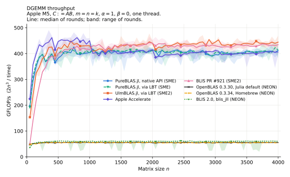
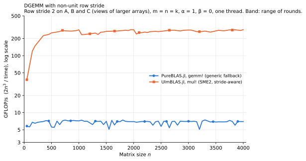

# blas-comparison

Experimental DGEMM comparison on an Apple M5: [PureBLAS.jl](https://github.com/el-oso/PureBLAS.jl),
[UlmBLAS.jl](https://github.com/michael-lehn/UlmBLAS.jl), OpenBLAS, Apple Accelerate and BLIS.
It aims to understand *why* they differ, not to declare a winner.

> **Preliminary.** Measured on one passively cooled laptop in everyday use. Campaigns are still being added.
> See the status table and [limitations](docs/REPORT.md#limitations).

- **[Report](docs/REPORT.md):** results, GEMM analysis, stride analysis, findings, limitations
- **[Methodology](docs/METHODOLOGY.md):** hardware, versions, thread settings, measurement, correctness checks

## Results at a glance



One thread, contiguous: all SME implementations reach about 400–450 GFLOP/s, 7–8 times NEON OpenBLAS. PureBLAS.jl leads UlmBLAS.jl by up to 28% for n ≤ 250, UlmBLAS.jl leads by about 7% for n ≥ 300, and Accelerate leads both for n ≤ 1000.



Row stride 2 (preliminary): UlmBLAS.jl is about 40 times faster for n ≥ 500, because PureBLAS.jl uses a generic scalar fallback for a C with non-unit stride. That fallback is documented upstream as a correctness path, not a fast one. Copying operands to contiguous buffers is used in the report **only as a diagnostic**, not as a proposed optimization: it would need O(n²) workspace, unsuitable for a general-purpose BLAS.

## Status

| Campaign | Content | Status |
|---|---|---|
| `validate` | All backends, 3 sizes | Final |
| `sweep` | 8 backends, n = 50:50:4000, one thread; 5 rounds SME, 3 rounds others | Final |
| `ladder` | Sizes around powers of two, 6 backends, 3 rounds | Final |
| `fresh` | Fresh operands per sample, 3 rounds | Final |
| `ctrl_n1000`, `ctrl_n2000`, `ctrl_n4000` | One size per process, 3 rounds | Final |
| `neon` | PureBLAS.jl with SME off, 3 rounds | Final |
| `mt` | 4 threads, 10 sizes, 6 backends, 3 rounds; UlmBLAS.jl is single-threaded | Final |
| `strided2` | Row stride 2, n = 50:50:4000 | **Preliminary:** PureBLAS.jl 2 of 3 rounds, UlmBLAS.jl 3 of 5 |
| `strided2/diagnostics` | Which operand and route cost what | **Preliminary:** one round; small sizes to be repeated |
| SME disassembly, micro-benchmarks | Generated code; FMOPA and load limits | **Not done** |

## Layout

```
src/        benchmark library: backends, harness, correctness checks, stride harness
scripts/    setup, campaign driver, analysis, plots
results/    one directory per campaign: raw/ (samples, checks, metadata), summary, acceptance report, log
plots/      SVG and PDF; prefix = campaign
docs/       report, methodology
```

## Reproduce

Needs macOS on Apple Silicon with SME for the SME backends. Everything goes to `.local/`; nothing is installed system-wide. Homebrew OpenBLAS is used only if already present.

```sh
scripts/setup.sh                    # local Julia, depot, Python plotting environment
scripts/build_blis_pr921.sh         # BLIS PR #921 for this machine
scripts/record_env.sh               # results/environment.txt

J=.local/bin/julia; export JULIA_DEPOT_PATH=$PWD/.local/depot
ALL=pureblas_native,pureblas_lbt,ulmblas,openblas,openblas_brew,accelerate,blis_jll,blis_pr921
$J --startup-file=no scripts/campaign.jl campaign=sweep sizes=50:50:4000 rounds=3 samples=5 backends=$ALL      # about 1 h
.local/venv/bin/python scripts/analyze.py sweep sweep

scripts/run_supplementary.sh        # ladder, fresh, one-size controls, NEON, multi-threaded; about 1 h

$J --startup-file=no scripts/campaign.jl campaign=strided2 script=run_strided.jl sizes=50:50:4000 \
   rounds=3 samples=5 backends=ulmblas_strided2,pureblas_strided2                                               # about 2.5 h
$J --project=. --startup-file=no -t 1,0 --gcthreads=1 scripts/strided_diagnostics.jl lib=pureblas out=results/strided2/diagnostics
$J --project=. --startup-file=no -t 1,0 --gcthreads=1 scripts/strided_diagnostics.jl lib=ulmblas  out=results/strided2/diagnostics
.local/venv/bin/python scripts/analyze_strided.py
```

Finished processes are skipped, so an interrupted campaign can be continued. `scripts/sanitize_results.py` removes machine-specific paths and process names from results before they are committed.

Versions of all Julia packages are pinned in `Manifest.toml`; PureBLAS.jl and UlmBLAS.jl are pinned to commits in `Project.toml`.
