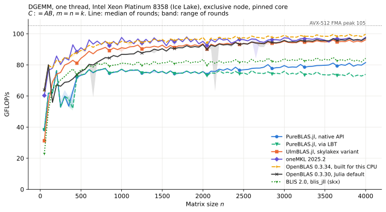
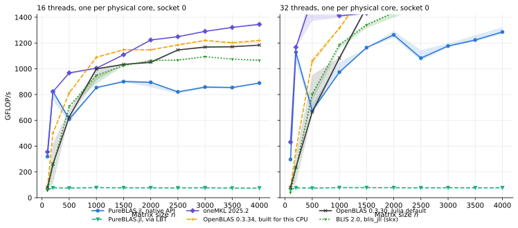
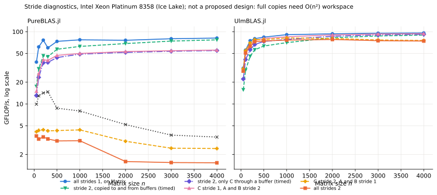

# DGEMM on Intel Ice Lake (bwUniCluster 3.0)

**Status: in progress.** Separate from the [Apple M5 report](REPORT.md); the two machines aren't compared directly here. See the [status table](#status).

The goal is the same as for the M5: understand why implementations differ, not declare a winner. Results below are labelled **measured** or **hypothesis**. Raw data: [`results/cluster-icelake`](../results/cluster-icelake); plots: `plots/cluster-icelake_*`.

## Why this node type

The scheduler estimated about 25 minutes for an exclusive Ice Lake node (`cpu_il`) and about 17 hours for an exclusive Zen 4 node (`cpu`). Ice Lake also has true 2×512-bit FMA units, so AVX-512 kernels have a full doubling to gain over AVX2. Users can't list nodes (`sinfo` is denied), so the choice rests on `squeue` and `sbatch --test-only`.

PureBLAS.jl's own benchmarks use Zen 3, Zen 4 and Zen 5. This is therefore also a test of how it carries over to a CPU it wasn't benchmarked on, and it doesn't check its published Zen figures.

## Setup

| | |
|---|---|
| CPU | 2 × Intel Xeon Platinum 8358, Ice Lake-SP, 32 cores each, SMT on, 4 NUMA nodes |
| Caches | L1d 48 KiB, L2 1.25 MiB, L3 48 MiB per socket |
| OS, frequency | RHEL 9.6, `intel_pstate`, governor `performance`, turbo on |
| Scheduler | One exclusive node per job, 64 GB requested; nothing else ran on the node |
| Julia | 1.13.3 |
| PureBLAS.jl | 0.1.2, `51228327`, default configuration, JIT and precompiled on Ice Lake: `_MR` 2, `_NR` 8, `_KC` 384, `_NC` 4088 |
| UlmBLAS.jl | `c67e4319`, `skylakex` variant of the pinned artifact |
| oneMKL | 2025.2 from `MKL_jll`, AVX-512 path, sequential layer for one thread, Intel OpenMP for several |
| OpenBLAS | 0.3.30 (Julia's default, core SkylakeX) and 0.3.34 built on Ice Lake with GCC 14.2 (core SKYLAKEX, pthreads) |
| BLIS | 2.0 from `blis_jll`, run-time configuration `skx` |

Full records per job: [`results/cluster-icelake/nodes`](../results/cluster-icelake/nodes), plus one `meta_*.txt` per process in each `raw` directory.

**Measurement:** same harness, inputs, checks and statistics as the [M5 methodology](METHODOLOGY.md), with these differences:

- One thread runs on core 3 with `numactl --physcpubind=3 --membind=0`.
- *t* threads use the first *t* physical cores of socket 0. Hardware siblings are never used. Memory is bound to one NUMA node or interleaved over those in use.
- The thermal and load guards are replaced by the exclusive node, a clock log, and a run of the FMA peak test before and after each job.
- Each job's slow-anchor rule is the same as for `strided2` on the M5: a cell is excluded if its median anchor exceeds 1.25 × the lower quartile of its process.

## Configurations chosen

A pilot on the development partition compared candidates before the campaign. Its data is in `results/cluster-icelake/pilot*` and isn't used in any statistic.

| Implementation | Tested | Used |
|---|---|---|
| UlmBLAS.jl | `skylakex` (96 GFLOP/s at n = 4000), `haswell` (50) | `skylakex` |
| OpenBLAS | Julia's 0.3.30, local 0.3.34 | both |
| PureBLAS.jl threads | Plain, `JULIA_EXCLUSIVE=1` (889 and 888 GFLOP/s at 16 threads) | plain |
| PureBLAS.jl tuning | Defaults. `tune!()` needs a source checkout, and its [knob registry](https://github.com/el-oso/PureBLAS.jl/blob/512283276b55aa70fe59d91f98f260eba0e8244c/docs/src/knobs.md) lists GEMM's block and kernel sizes as derived from the hardware rather than measured | defaults; `tune!()` not run |

Not included: AOCL and Eigen, which the earlier ulmBLAS campaigns on this machine cover, and 64 threads across both sockets.

## One thread (measured)

FMA peak of the core: 105 GFLOP/s with zmm registers and 54 with ymm, the same on all nodes to within 0.02%. Median GFLOP/s:



| n | 50 | 100 | 200 | 300 | 500 | 1000 | 2000 | 4000 |
|---|---:|---:|---:|---:|---:|---:|---:|---:|
| PureBLAS.jl, native API | 39 | 62 | 76 | 60 | 73 | 77 | 76 | 82 |
| PureBLAS.jl, via LBT | 38 | 62 | 76 | 60 | 74 | 77 | 76 | 74 |
| UlmBLAS.jl | 31 | 56 | 74 | 80 | 84 | 91 | 94 | 96 |
| oneMKL 2025.2 | 60 | 76 | 86 | 85 | 91 | 98 | 95 | 97 |
| OpenBLAS 0.3.34, local | 64 | 80 | 83 | 85 | 89 | 95 | 98 | 100 |
| OpenBLAS 0.3.30, Julia | 64 | 80 | 67 | 69 | 76 | 87 | 93 | 97 |
| BLIS 2.0 | 23 | 50 | 67 | 73 | 77 | 81 | 84 | 84 |

- **Top group:** for n ≥ 1000, local OpenBLAS (median 97.5), oneMKL (96.0), UlmBLAS (93.7) and Julia's OpenBLAS (93.6) are within about 4% of each other, and reach about 89–93% of the FMA peak.
- **UlmBLAS.jl and oneMKL:** UlmBLAS reaches 0.98 of oneMKL for n ≥ 1000 and 0.95 for 300 ≤ n ≤ 950, but only 0.52 at n = 50.
- **PureBLAS.jl against UlmBLAS.jl:** PureBLAS is ahead at n = 50 and 100 (+24%, +11%), mixed at n = 150 and 200, behind from n = 250 on, and at 0.83 for n ≥ 1000. So its small-size lead carries over from the M5, while the larger gap on the plateau doesn't look like the M5's 7%.
- **A dip in PureBLAS.jl around n = 250–450:** it falls from 76 at n = 200 to 60 at n = 300, and is at 0.66 of UlmBLAS at n = 350. **Hypothesis:** a switch between kernel paths, as its source has [size-dependent routes](https://github.com/el-oso/PureBLAS.jl/blob/512283276b55aa70fe59d91f98f260eba0e8244c/src/blas3/gemm.jl#L3780). Not checked.
- **Native API and LBT differ for PureBLAS.jl at large n:** LBT reaches 0.91 of native at n = 4000. They are equal for n ≤ 250. The cause isn't established.
- **Newer OpenBLAS helps small sizes most:** 0.3.34 is about 23% ahead of 0.3.30 for n ≤ 250, 15% for 300 ≤ n ≤ 950, and 4% from n = 1000.

Also: [PureBLAS vs UlmBLAS](../plots/cluster-icelake_sweep_t1_pureblas_vs_ulmblas.svg), [vs oneMKL](../plots/cluster-icelake_sweep_t1_vs_mkl.svg), [small sizes](../plots/cluster-icelake_sweep_t1_small.svg).

**Reproducibility:** rounds run on two separate exclusive nodes. For n ≥ 1000, the median throughput ratio between the nodes is 0.997–1.003 per library. The one-size-per-process controls at n = 1000 and 4000 agree with the sweep within 0.3% for every library, including the LBT gap at n = 4000 (73.8 against 81.3), so process state and order don't explain these results. For most libraries the rounds differ by a median of at most about 0.5% (`acceptance.md`). There are isolated slow samples, such as OpenBLAS 0.3.30 at n = 2150 (1.46× between rounds), which medians absorb. The scalar anchor flagged none of the 2800 sweep cells. Correctness: all 2800 checks pass, with 0 bytes allocated.

## Multi-threaded (measured)

Reported separately. Each size has 3 rounds, with 2 of 360 cells excluded by the anchor rule. GFLOP/s, with UlmBLAS.jl absent because it is single-threaded:



| | n = 1000, 16 threads | n = 1000, 32 | n = 4000, 16 | n = 4000, 32 |
|---|---:|---:|---:|---:|
| oneMKL 2025.2 | 1004 | 1411 | 1345 | 1903 |
| OpenBLAS 0.3.34, local | 1089 | 1316 | 1220 | 1732 |
| OpenBLAS 0.3.30, Julia | 1000 | 1084 | 1184 | 1607 |
| BLIS 2.0 | 949 | 1186 | 1065 | 1590 |
| PureBLAS.jl, native API | 854 | 974 | 890 | 1286 |
| PureBLAS.jl, via LBT | 78 | 78 | 74 | 77 |

- **Parallel efficiency at n = 4000:** at 16 threads, against one thread, oneMKL reaches 86%, OpenBLAS 0.3.34 76% and PureBLAS 68%.
- **PureBLAS.jl through LBT doesn't use threads:** cpu/wall stays at 1.00 although `set_num_threads` was called, so `LinearAlgebra.BLAS.gemm!` stays at single-thread speed here. The native API does use them (cpu/wall about 15.7 and 31.4). The cause isn't established, and it may be intended.
- **Clock:** the logged frequency isn't reliable for these runs, so per-core clocks under load aren't reported. Single-thread runs log about 3.3 GHz, which agrees with the FMA peak test.

## Row stride 2 (preliminary: diagnostics only)

**The stride sweep is still running.** The diagnostics below are finished: one round, three samples per point, all results verified. GFLOP/s:



| | n = 50 | 100 | 300 | 1000 | 2000 | 4000 |
|---|---:|---:|---:|---:|---:|---:|
| PureBLAS.jl, contiguous | 38 | 62 | 60 | 77 | 76 | 82 |
| PureBLAS.jl, C stride 1, A, B stride 2 | 15 | 26 | 40 | 50 | 53 | 56 |
| PureBLAS.jl, `_gemm_generic!` on `Matrix` | 9.9 | 13 | 15 | 8.0 | 5.2 | 3.5 |
| PureBLAS.jl, all strides 2 | 3.6 | 3.3 | 3.3 | 3.1 | 1.6 | 1.5 |
| PureBLAS.jl, stride 2 + full copies *(diagnostic)* | 17 | 31 | 45 | 63 | 68 | 77 |
| UlmBLAS.jl, contiguous | 31 | 56 | 80 | 91 | 93 | 96 |
| UlmBLAS.jl, all strides 2 | 29 | 51 | 73 | 76 | 78 | 74 |
| UlmBLAS.jl, stride 2 + full copies *(diagnostic)* | 16 | 29 | 56 | 71 | 82 | 90 |

> **The copy rows are a diagnostic, not a proposed optimization.** They need O(n²) workspace, as explained in the [M5 report](REPORT.md#is-the-generic-fallback-responsible-yes-for-essentially-the-whole-gap). That is unsuitable for a general-purpose BLAS suitable for LAPACK, where workspace has to be bounded and allocation predictable.

- **The same fallback decides here too:** PureBLAS routes a stride-2 C to `_gemm_generic!`. UlmBLAS/PureBLAS is about 8× at n = 50, 25× at n = 1000 and 48× at n = 4000.
- **The fallback gets worse with size:** PureBLAS falls from 3.1 at n = 1000 to 1.5 at n = 4000, and `_gemm_generic!` falls on contiguous data too (8.0 to 3.5), once the unblocked loop outgrows the caches. **Hypothesis:** that is the cause. Not checked.
- **Without the fallback, the gap closes at large n:** PureBLAS with copies (77) is level with UlmBLAS's direct path (74) at n = 4000.
- **UlmBLAS.jl's direct path beats copying up to n = 1000:** 29 against 16 at n = 50, and 76 against 71 at n = 1000. Copies only win from about n = 2000 (+21% at n = 4000).
- **UlmBLAS.jl's overhead is almost all in C:** at n = 4000 the extra time per flop is 8% for packing and 92% for C tile output, and the costs add up (sum 3.06 against all-strides 3.06 ms per 10⁹ flops). On the M5 the split was 27% and 73%.

## Limitations

- **The stride sweep is incomplete**; see the status table.
- **One CPU type, one socket for threads.** No Zen runs, and no 64-thread runs.
- **Turbo on:** frequency wasn't locked, because users can't change it. The FMA peak test agrees across nodes and jobs to 0.02%, and the anchors are tight (p01 and p99 within 3% of the median in the sweep).
- **PureBLAS.jl defaults:** `tune!()` wasn't run. A tuned install could differ, though GEMM's block sizes are derived rather than calibrated.
- **Diagnostics:** one round, so they show sizes of effects rather than precise values.

## Status

| Job | Content | Status |
|---|---|---|
| `bc-mt` | 16 and 32 threads, 10 sizes, 3 rounds | Finished |
| `bc-diag` | Stride route diagnostics | Finished |
| `bc-sweep-a`, `bc-sweep-b` | n = 50:50:4000, one thread, 5 rounds on two nodes; one-size controls at n = 1000, 4000, 3 rounds | Finished |
| `bc-strided` | Row stride 2, PureBLAS.jl 3 rounds, UlmBLAS.jl 5 | **Running**: no finished process yet |

## Reproduce

Needs Slurm, `numactl` and an Ice Lake partition; adjust the partition in `cluster/job.sbatch`.

```sh
cd cluster && julia --project=. -e 'using Pkg; Pkg.instantiate()' && cd ..    # on a login node, for downloads only
sbatch cluster/pilot.sbatch                                                   # precompile on the target CPU, build OpenBLAS
for s in sweep_a sweep_b mt strided diag; do sbatch -t 14:00:00 -J bc-$s cluster/job.sbatch $s; done
python cluster/analyze.py
```

`pilot.sbatch` reads `W_SRC` (directory of the OpenBLAS 0.3.34 tarball), and `job.sbatch` reads `PEAK` (the FMA peak program).
