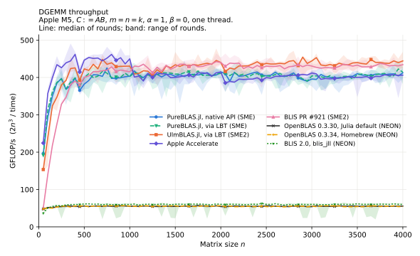
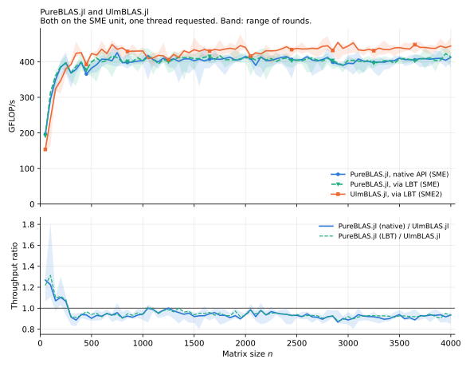
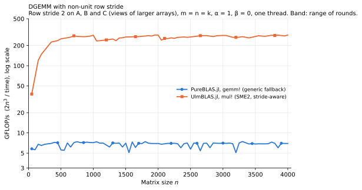
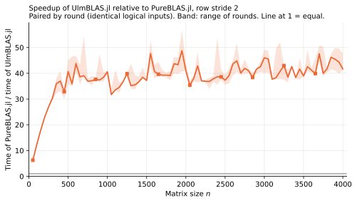
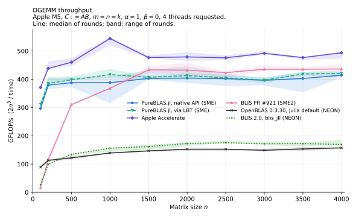

# DGEMM on Apple M5: PureBLAS.jl, UlmBLAS.jl and references

**Status: preliminary, updated as campaigns finish.** See the [status table](../README.md#status).
The goal is to understand *why* implementations differ, not to declare a winner. All numbers come from one
passively cooled laptop; read [Limitations](#limitations) before quoting any of them.

Labels used below: **measured** (in this repository, with raw data), **source** (read in the pinned source,
with a link), **claimed** (stated by a project, not verified here), **hypothesis** (not tested).

Pinned versions: PureBLAS.jl [`51228327`](https://github.com/el-oso/PureBLAS.jl/tree/512283276b55aa70fe59d91f98f260eba0e8244c)
(0.1.2), UlmBLAS.jl [`c67e4319`](https://github.com/michael-lehn/UlmBLAS.jl/tree/c67e43196d621d45c3578e8ce2c1f8917284318c),
ulmBLAS [`6c554eec`](https://github.com/michael-lehn/ulmBLAS/tree/6c554eec707e22f118bae5dcaea10ad9945aac54).
[Methodology](METHODOLOGY.md) lists hardware, software, thread settings and statistics.

## 1. Summary

**Contiguous, one thread (measured; final).** Above n ≈ 300 all SME implementations sit on nearly the same plateau.
OpenBLAS and blis_jll (NEON) are 7–8 times slower.

| n | PureBLAS native | PureBLAS LBT | UlmBLAS | Accelerate | BLIS PR #921 | OpenBLAS 0.3.30 | blis_jll |
|---:|---:|---:|---:|---:|---:|---:|---:|
| 50 | 197 | 192 | 154 | 225 | 50 | 48 | 36 |
| 100 | 295 | 314 | 240 | 357 | 140 | 52 | 51 |
| 200 | 385 | 387 | 348 | 434 | 276 | 54 | 57 |
| 500 | 382 | 400 | 423 | 447 | 400 | 56 | 62 |
| 1000 | 404 | 402 | 430 | 450 | 415 | 55 | 60 |
| 1050 | 418 | 413 | 409 | 401 | 431 | 55 | 61 |
| 2000 | 415 | 411 | 440 | 415 | 440 | 54 | 60 |
| 4000 | 412 | 414 | 444 | 406 | 434 | 56 | 60 |

GFLOP/s, median over rounds. 

Also: [vs OpenBLAS](../plots/sweep_t1_vs_openblas.svg), [vs Accelerate](../plots/sweep_t1_vs_accelerate.svg).

**Row stride 2 (measured; preliminary: PureBLAS 2 of 3 rounds, UlmBLAS 3 of 5).** UlmBLAS is about 40 times faster
for n ≥ 500. Essentially all of that gap comes from PureBLAS's generic fallback ([section 5](#5-non-unit-row-strides)).

| n | 50 | 100 | 200 | 500 | 1000 | 2000 | 4000 |
|---|---:|---:|---:|---:|---:|---:|---:|
| PureBLAS.jl | 5.8 | 5.8 | 6.5 | 6.3 | 6.9 | 6.9 | 6.9 |
| UlmBLAS.jl | 39 | 79 | 149 | 250 | 273 | 284 | 284 |
| speedup | 6.5 | 13 | 23 | 40 | 40 | 41 | 41 |

## 2. Interpretation of the contiguous results

All **measured**, from `results/sweep`; explanations are marked where they are not.

- **n ≥ 300:** PureBLAS/UlmBLAS has median 0.93 (range 0.87–1.02). UlmBLAS is ahead by about 7%, except just above n = 1024.
- **n ≤ 250:** PureBLAS is ahead by 28% at n = 50, 23% at 100, 5% at 250. **Hypothesis:** its in-place use of A, without
  packing, helps most where the packing share is largest.
- **Accelerate** is the fastest for n ≤ 1000 and has a step between n = 1000 (450) and n = 1050 (401); the plateau is about 451 before and 403 after. The cause is unknown (closed source).
- **UlmBLAS** drops about 5% just above n = 1024 (430 to 409, also visible with stride 2 at 1050 and 2050). This fits the fixed KC = 1024 ([`gemm.tcc`](https://github.com/michael-lehn/ulmBLAS/blob/6c554eec707e22f118bae5dcaea10ad9945aac54/ulmblas/level3/gemm.tcc#L47-L49)): a thin second block follows. PureBLAS shows no such step: it chooses KC per call
  ([`_sme_blocks`](https://github.com/el-oso/PureBLAS.jl/blob/512283276b55aa70fe59d91f98f260eba0e8244c/src/blas3/sme_kernel.jl#L696-L727)).
- **Native vs LBT PureBLAS:** no consistent difference on the plateau (median 406 for both, n ≥ 1000).

### Controls

| control | result (measured) |
|---|---|
| One size per process (`results/ctrl_n*`), n = 1000 / 2000 / 4000 | PureBLAS 415 / 426 / 433, UlmBLAS 436 / 456 / 461, Accelerate 484 / 439 / 425. Absolute values 1–8% above the sweep; UlmBLAS/PureBLAS 1.05 / 1.07 / 1.07, against 1.07 / 1.06 / 1.08 in the sweep. The ratio holds. |
| Fresh operands before each sample (`results/fresh`), n = 200 / 1000 / 2000 / 4000 | PureBLAS 350 / 379 / 409 / 392, UlmBLAS 341 / 411 / 435 / 437, Accelerate 434 / 458 / 414 / 404. Against reused operands: PureBLAS 1–9% lower, UlmBLAS 1–4% lower, Accelerate unchanged (within 2%). So reusing operands slightly favours PureBLAS and UlmBLAS over Accelerate, and PureBLAS's lead over UlmBLAS at n = 200 shrinks from 1.11 to 1.03 with fresh operands. |
| Sizes with `n*8` a multiple of a power of two (`results/ladder`) | No collapse at n = 1024, 2048, 4096 for any library. The 50:50:4000 grid therefore does not hide an aliasing problem. |
| PureBLAS with SME off, by its own `sme_f64` preference (`results/neon`) | About 39 GFLOP/s, below OpenBLAS (55). So the SME kernel is what makes it competitive on this machine. PureBLAS's route with packed stride-2 A and B reaches 52 ([section 5](#5-non-unit-row-strides)), more than its contiguous NEON route; this is not explained yet. |

### Multi-threading, four threads requested (measured; separate from everything else)

`results/mt`, final, reduced grid. UlmBLAS is single-threaded and not included. SME is not threading: the M5's SME
capability and core threads are separate questions, and cpu/wall shows which threads actually worked.

| n | PureBLAS native | PureBLAS LBT | Accelerate | BLIS PR #921 | OpenBLAS | blis_jll |
|---:|---:|---:|---:|---:|---:|---:|
| 1000 | 388 | 417 | 544 | 368 | 139 | 156 |
| 2000 | 404 | 413 | 479 | 432 | 152 | 173 |
| 4000 | 414 | 421 | 494 | 436 | 157 | 169 |
| cpu/wall | about 1 | about 1 | up to 2.0 | 2.9–4.0 | 2.9–4.3 | 3.2–4.0 |

- PureBLAS stays on one thread here on purpose ([`_sme_owns`](https://github.com/el-oso/PureBLAS.jl/blob/512283276b55aa70fe59d91f98f260eba0e8244c/src/blas3/sme_kernel.jl#L1132)), with no loss.
- BLIS PR #921 uses 3–4 CPUs for no gain over one thread (434 at n = 4000 with one thread). **Hypothesis:** four threads contend for one SME unit.
- Accelerate is the only SME implementation that gains from threads here: 15–22% for n ≥ 1000 with at most 2 CPUs, under 5% for n ≤ 500. How it does this is unknown.
- OpenBLAS scales by about 2.8 on four cores.

## 3. How PureBLAS.jl computes DGEMM

Everything in this section is **source**, unless marked otherwise. Base:
[`src/blas3/gemm.jl`](https://github.com/el-oso/PureBLAS.jl/blob/512283276b55aa70fe59d91f98f260eba0e8244c/src/blas3/gemm.jl),
[`src/blas3/sme_kernel.jl`](https://github.com/el-oso/PureBLAS.jl/blob/512283276b55aa70fe59d91f98f260eba0e8244c/src/blas3/sme_kernel.jl),
[`src/cpuinfo.jl`](https://github.com/el-oso/PureBLAS.jl/blob/512283276b55aa70fe59d91f98f260eba0e8244c/src/cpuinfo.jl).

**Route selection** ([`_gemm_core_body!`](https://github.com/el-oso/PureBLAS.jl/blob/512283276b55aa70fe59d91f98f260eba0e8244c/src/blas3/gemm.jl#L3664)): tiny, SME, Strassen, unpacked, blocked; otherwise
[`_gemm_generic!`](https://github.com/el-oso/PureBLAS.jl/blob/512283276b55aa70fe59d91f98f260eba0e8244c/src/blas3/gemm.jl#L1540-L1561).

**Classical blocked path:** BLIS/Goto structure, with [no packing of B when it is contiguous](https://github.com/el-oso/PureBLAS.jl/blob/512283276b55aa70fe59d91f98f260eba0e8244c/src/blas3/gemm.jl#L875), accumulators starting from zero, and C added once. **Strassen** ([from line 1650](https://github.com/el-oso/PureBLAS.jl/blob/512283276b55aa70fe59d91f98f260eba0e8244c/src/blas3/gemm.jl#L1650)) is used on x86 and is **claimed** to be why it beats OpenBLAS and AOCL at n = 2048 and 4096 ([numbers in the source](https://github.com/el-oso/PureBLAS.jl/blob/512283276b55aa70fe59d91f98f260eba0e8244c/src/blas3/gemm.jl#L3579)). Not tested here: no x86 machine.

**Hardware adaptation** is a mix:

- *Theoretical:* cache sizes read through `sysctl` or CPUID ([`cpuinfo.jl:62`](https://github.com/el-oso/PureBLAS.jl/blob/512283276b55aa70fe59d91f98f260eba0e8244c/src/cpuinfo.jl#L62-L93)), MC as 30% of L2, NC as 1/4 of L3 ([`:344-352`](https://github.com/el-oso/PureBLAS.jl/blob/512283276b55aa70fe59d91f98f260eba0e8244c/src/cpuinfo.jl#L344-L352)).
- *Empirical constants:* such as `_ILP_TARGET=16` ([`:332`](https://github.com/el-oso/PureBLAS.jl/blob/512283276b55aa70fe59d91f98f260eba0e8244c/src/cpuinfo.jl#L332)), a value fitting x86, and `_at_strassen_min = 256` ([`:589`](https://github.com/el-oso/PureBLAS.jl/blob/512283276b55aa70fe59d91f98f260eba0e8244c/src/cpuinfo.jl#L589)). In the source, comments classify 94 constants as *Literal*, 85 *Derived*, 45 *Exempt* and 26 *Measured*.
- *No search at run time:* there is no ATLAS-style tuning at install or load, except a self-test of the SME kernel at start-up ([`:918`](https://github.com/el-oso/PureBLAS.jl/blob/512283276b55aa70fe59d91f98f260eba0e8244c/src/blas3/sme_kernel.jl#L918)).

The README says it uses a "formula rather than a number measured once". That holds for the block-size formulas, while several inputs and cut-offs in them are tuned literals.

**Compared with BLIS-style ulmBLAS.** Established: the 5-loop structure, packing, micro-tile kernels. Less common: skipping B packing and packing A in place when it fits; a kernel in pure Julia; the per-call KC formula; routing to Strassen. Not new: Strassen for GEMM, and using ZA as a transpose buffer (ulmBLAS does this too).

### Apple SME from Julia to instructions

([`sme_kernel.jl:1-30`](https://github.com/el-oso/PureBLAS.jl/blob/512283276b55aa70fe59d91f98f260eba0e8244c/src/blas3/sme_kernel.jl#L1-L30)). No assembler and no C: the kernel is LLVM IR generated as strings ([`_sme_macro_ir`](https://github.com/el-oso/PureBLAS.jl/blob/512283276b55aa70fe59d91f98f260eba0e8244c/src/blas3/sme_kernel.jl#L116-L297)) and passed to `Base.llvmcall`. The function attributes `aarch64_pstate_sm_body` and `aarch64_inout_za` let LLVM switch into streaming mode; ZA is enabled and disabled explicitly. The kernel is a `noinline` sibling, reached through a cfunction trampoline, so the streaming code does not become part of ordinary pre-compiled code. Disassembly of what LLVM actually produces is **still to be done**; this description comes from the IR.

| | PureBLAS.jl | ulmBLAS |
|---|---|---|
| Language | LLVM IR from Julia, JIT on the host | C++ intrinsics with ACLE attributes |
| Tile | 16×16, 4 ZA tiles, vertical slices | [32×16, 8 tiles, horizontal slices](https://github.com/michael-lehn/ulmBLAS/blob/6c554eec707e22f118bae5dcaea10ad9945aac54/ulmblas/level3/ukernel/sme/ugemm.tcc) (derived from [BLIS PR #921](https://github.com/flame/blis/pull/921)) |
| Loads | single vector | multi-vector (x4, x2) |
| Streaming session | one per macro-kernel, panel loops inside | one per tile |
| Prefetch | none in the SME kernel | PRFM in ordinary mode before entering |
| Packing A | [plain Julia, non-streaming](https://github.com/el-oso/PureBLAS.jl/blob/512283276b55aa70fe59d91f98f260eba0e8244c/src/blas3/sme_kernel.jl#L449-L483), or in place | [streaming](https://github.com/michael-lehn/ulmBLAS/blob/6c554eec707e22f118bae5dcaea10ad9945aac54/ulmblas/level3/ukernel/sme/pack.tcc#L41-L54) |
| Packing B | [ZA as a transpose buffer](https://github.com/el-oso/PureBLAS.jl/blob/512283276b55aa70fe59d91f98f260eba0e8244c/src/blas3/sme_kernel.jl#L350-L420) | [ZA as a transpose buffer](https://github.com/michael-lehn/ulmBLAS/blob/6c554eec707e22f118bae5dcaea10ad9945aac54/ulmblas/level3/ukernel/sme/pack.tcc#L114-L148) |
| Block sizes | per call: [NC = n, KC from a 64 MB budget, MC from L2](https://github.com/el-oso/PureBLAS.jl/blob/512283276b55aa70fe59d91f98f260eba0e8244c/src/blas3/sme_kernel.jl#L694-L727) | [fixed](https://github.com/michael-lehn/ulmBLAS/blob/6c554eec707e22f118bae5dcaea10ad9945aac54/ulmblas/level3/gemm.tcc#L47-L49): MC 384, KC 1024, NC 1024 |
| Edges | predicated inside the kernel | predicated or tile buffer |

**Load traffic (analysis):** PureBLAS loads one vector per FMOPA, ulmBLAS 0.75. At 500 GFLOP/s that is about 250 versus 187 GB/s.
**Hypothesis:** this contributes to the 7% plateau difference. It is not tested separately.

## 4. PureBLAS's claims against these measurements

The numbers below compare PureBLAS's published M6 figures with M5 measurements here. Different chips, so agreement is informative and small differences are not.

| claim ([`docs/src/performance_apple.md`](https://github.com/el-oso/PureBLAS.jl/blob/512283276b55aa70fe59d91f98f260eba0e8244c/docs/src/performance_apple.md)) | measured here (M5) |
|---|---|
| GEMM vs Accelerate: n = 50: 0.88, n = 100: 0.83 | 0.875, 0.826 |
| GEMM vs Accelerate: n = 512: 0.95, n = 1000: 0.93 | 0.97, 0.90 |
| GEMM reaches parity with Accelerate from n = 2048 | 1.00 at n = 2048, 1.03 at n = 4096 |
| GEMM vs OpenBLAS: median about 6.9 | about 7.4 at n ≥ 1000 |

**So the Apple GEMM claims I could test hold up.** The project's own documentation is also more cautious than its headline: it reports that many Apple cells fall below its gate, calls unlocked Apple results "directional", and warns that in-process comparisons can depend on shape.

Not verifiable here:

- **Zen 3, 4 and 5 results and "87% of cells":** no x86 machine, and the cached raw benchmark data are git-ignored upstream, so the ratios cannot be recomputed from the repository.
- **Gate design:** the gate samples a [finite ladder of sizes](https://github.com/el-oso/PureBLAS.jl/blob/512283276b55aa70fe59d91f98f260eba0e8244c/docs/src/methodology.md), and the source shows cut-offs tuned to those cells. That invites overfitting between the sampled sizes. On the M5, the ladder and the dense grid here tell the same story.
- **README details:** "roughly 36k lines" against 64,641 lines in `src` (44,022 of code), and "single-threaded for now" against threaded code and documentation. These appear to be out of date rather than meaningful.

## 5. Non-unit row strides

Campaign `strided2`: A, B, C are `view(P, 1:2:2n, 1:n)` of larger arrays, with the same logical values as the contiguous sweep (CRC identical in all pairs). All checks pass; see [`acceptance.md`](../results/strided2/acceptance.md).

**Neither library converts before the call (measured):**
- The gap rows hold NaN in A and B, so reading them would poison the result, and a sentinel in C, which stays intact (all sizes and rounds).
- The result is read from the parent array of C, and the timed region allocates 0 bytes.
- UlmBLAS: a spy on the C call shows the strides `(2, 2n)` for all operands.
- PureBLAS: `gemm!` receives the `SubArray`, `_strided1(view) == false`, and the SME counter stays at 0.
- Internal packing is allowed by the task, and it is timed.

### Internal handling

**PureBLAS (source; confirmed by profiles and counters).** Three routes, depending on the operand strides:

| Strides | Route | Measured at n = 4000 |
|---|---|---:|
| C, A, B all 1 | SME: [`_sme_eligible`](https://github.com/el-oso/PureBLAS.jl/blob/512283276b55aa70fe59d91f98f260eba0e8244c/src/blas3/sme_kernel.jl#L1118-L1121) requires `_strided1` for all three | 387 |
| C stride 1, A or B stride 2 | Blocked NEON with [element-wise packing](https://github.com/el-oso/PureBLAS.jl/blob/512283276b55aa70fe59d91f98f260eba0e8244c/src/blas3/gemm.jl#L459-L483) | 52 |
| C stride ≠ 1 | [`gemm!`](https://github.com/el-oso/PureBLAS.jl/blob/512283276b55aa70fe59d91f98f260eba0e8244c/src/blas3/gemm.jl#L6014) sends it to [`_gemm_generic!`](https://github.com/el-oso/PureBLAS.jl/blob/512283276b55aa70fe59d91f98f260eba0e8244c/src/blas3/gemm.jl#L1540-L1561): scalar j-p-i triple loop, no blocking, no packing | 7.2–7.6 |

The source describes that fallback as "Correct and AD-traceable; not blocked". It is a correctness path that also serves dual numbers and similar types, and PureBLAS makes no performance claim for it. This benchmark should not be read as criticism of a feature it advertises.

**UlmBLAS (source).** The [SME kernel stays in use](https://github.com/michael-lehn/ulmBLAS/blob/6c554eec707e22f118bae5dcaea10ad9945aac54/ulmblas/level3/ukernel/sme/ugemm.tcc#L256-L275): it computes into a local tile `C_[MR*NR]`, then merges to C with a scalar loop in ordinary mode. A and B go through the [portable packing routines](https://github.com/michael-lehn/ulmBLAS/blob/6c554eec707e22f118bae5dcaea10ad9945aac54/ulmblas/level3/ukernel/sme/pack.tcc#L187-L190) when neither stride is 1. Workspace stays bounded by block sizes.

### Is the generic fallback responsible? Yes, for essentially the whole gap

Diagnostic runs (one round, three samples, `results/strided2/diagnostics`, [plot](../plots/strided2_diagnostics_routes.svg)). All results verified.

> **The "copy" rows are a diagnostic, not a proposed optimization for either library.** They copy all three operands to contiguous buffers and call the contiguous path, to separate the cost of the route from the cost of the strides. Full-matrix copying needs O(n²) extra workspace (about 384 MB at n = 4000), with allocation behaviour depending on the problem size. That is not acceptable for a general-purpose BLAS suitable for LAPACK, where workspace has to be bounded and allocation predictable. ulmBLAS's bounded design is a feature; the copies below only measure what its stride path costs.

| GFLOP/s | n = 200 | 500 | 1000 | 2000 | 3000 | 4000 |
|---|---:|---:|---:|---:|---:|---:|
| PureBLAS, contiguous (SME) | 385 | 362 | 416 | 409 | 394 | 387 |
| PureBLAS, `_gemm_generic!` on `Matrix` | 17 | 17 | 17 | 16 | 15 | 15 |
| PureBLAS, all strides 2 | 7.2 | 7.3 | 7.6 | 7.5 | 7.4 | 7.2 |
| PureBLAS, stride 2 + full copies *(diagnostic)* | 165 | 271 | 322 | 360 | 376 | 365 |
| UlmBLAS, contiguous | 354 | 441 | 439 | 453 | 450 | 452 |
| UlmBLAS, all strides 2 | 148 | 255 | 287 | 288 | 291 | 292 |
| UlmBLAS, stride 2 + full copies *(diagnostic)* | 156 | 278 | 346 | 389 | 407 | 419 |

- **Size of the gap:** at n = 4000, UlmBLAS/PureBLAS is 292/7.2, about 41×.
- **Without the fallback the sign reverses:** PureBLAS with copies (365) would be ahead of UlmBLAS's direct path (292). So the route accounts for more than the whole gap; the strides themselves do not.
- **Inside PureBLAS's 54×** (387 to 7.2): about 25× comes from leaving the SME path for the scalar loop (387 to 15) on contiguous data. The further 2× (15 to 7.2) comes from the stride of C: with C stride 2 and A, B stride 1 it is already 7.6. **Hypothesis:** the contiguous loop vectorizes and the strided one does not. To be checked in the generated code.
- **Profile (n = 1000):** in PureBLAS, 2572 of 2580 samples are in `_setindex!` under `_gemm_generic!`, which confirms the route at run time.
- **Why the speedup is smaller for small n:** PureBLAS is flat at about 6–7, while UlmBLAS's tile and packing overhead dominates for small n, so its throughput climbs from 39 to about 250 by n = 500.

### Where UlmBLAS's stride overhead goes (measured)

Time per flop at n = 4000, compared with contiguous (452 GFLOP/s, 2.21 ms per 10¹² flops):

| Configuration | GFLOP/s | Extra time | Share |
|---|---:|---:|---:|
| A, B stride 2, C stride 1: packing | 393 | +0.33 | 27% |
| C stride 2, A, B stride 1: tile output | 324 | +0.88 | 73% |
| All strides 2 | 292 | +1.21 (sum of the above: 1.20) | |

The costs are additive, so packing and tile output can be optimized separately. At n = 1000 the profile says that the tile-output cost divides about evenly between the scalar merge loop (0.56 samples per call) and **a slower kernel** when the destination is the tile buffer (3.46 against 2.92 samples per call). The cause of the latter is **not established**. Profile attribution around a streaming-mode transition may also be imprecise.

## 6. Five findings

1. **Very different implementations reach one plateau.** Pure-Julia LLVM IR, C++ intrinsics, BLIS and Accelerate are all at about 400–450 GFLOP/s, which suggests a limit in the SME unit rather than in the software. The remaining differences are 7–10% on the plateau and larger for small n.
2. **SME from pure Julia works and is competitive.** PureBLAS generates its SME kernels as LLVM IR with no external code and comes within 7% of a hand-tuned kernel. Its Apple GEMM claims reproduce closely on a different chip.
3. **Each library loses somewhere else.** PureBLAS leads UlmBLAS by up to 28% for n ≤ 250, UlmBLAS leads by about 7% for n ≥ 300, and Accelerate leads both for n ≤ 1000 and falls behind UlmBLAS above that.
4. **Stride handling decides by a factor of 40, and it is the route, not the arithmetic.** PureBLAS has three routes at 400, 52 and 7 GFLOP/s, selected by the strides. UlmBLAS loses 35% with strides and keeps its workspace bounded.
5. **Threads do not simply help SME.** BLIS PR #921 uses 3–4 CPUs for the same throughput as one thread, PureBLAS deliberately stays on one, and only Accelerate gains (15–22% for n ≥ 1000).

## 7. Optimization opportunities for ulmBLAS

All keep workspace bounded by block sizes; none relies on copying whole matrices. None has been tested here yet, so the expected gains are upper bounds from the measurements above.

| Idea | Evidence | Possible gain |
|---|---|---|
| Choose KC per call so no thin final block follows, e.g. divide k evenly among the blocks | 5% step just above n = 1024; absent in PureBLAS | up to 5% near those sizes |
| Avoid packing A when it fits in cache, as PureBLAS does; no workspace needed | PureBLAS +28% at n = 50, +5% at n = 250 | Part of that at small n (also needs its aliasing guard) |
| Find out why the kernel is slower with the tile-buffer destination | About half of the 73% share above | up to about 13% with C stride ≠ 1 |
| Faster merge of the tile into C: for instance storing ZA slices with stride-specific instructions, or a vectorized merge | The other half | up to about 13% with C stride ≠ 1 |
| Vector packing for non-unit strides, at least for small strides | 27% of the overhead; `pack_MRxk` is scalar for these | up to about 10% with A, B stride ≠ 1 |
| Investigate Accelerate's lead for n ≤ 1000 (5.6% median, 46% at n = 50) | Sweep; cause unknown, closed source | unknown |

## 8. Questions for the PureBLAS author

Not sent. Nobody has been contacted.

1. Is `_gemm_generic!` the intended route for BLAS element types with a non-unit row stride of C, or simply not yet a priority?
2. Could `_sme_eligible` accept stride-2 A and B, given that A and B are packed anyway?
3. Is the raw data behind the gate (`bench/plots_data_*`) available, so that ratios can be recomputed?
4. On the M5, the NEON route with SME off reaches 39 GFLOP/s, and the packed route reaches 52. Is the default NEON route expected to be slower on Apple? Is the `_ILP_TARGET` literal, which fits x86, relevant here?
5. How do you see the L1-way aliasing measurement behind `_SME_INPLACE_NJP`, which, per a source comment, used scalar pointer chasing rather than SME loads?
6. Was one streaming session per macro-kernel measured against one per tile on the M-series?

## 9. Author and history

From public GitHub data only. GitHub user `el-oso`; repository created 2026-07-01; sole contributor; 1427 commits at the pinned revision. Commits by month: June 23, July 579, August 492, September 273, October 60. About 1600 commit trailers name Claude models as co-author, and the repository contains agent instructions (`CLAUDE.md`, `APPLE.md`), so development is heavily AI-assisted. SME work starts on 2026-09-25. At the pinned commit: version 0.1.2, tags v0.1.0 to v0.1.2, not in Julia's General registry. Sibling projects by the same account include PureFFT and PureSparse.

## 10. Is a direct comparison meaningful?

**Yes, with conditions.** For contiguous DGEMM both solve the same problem correctly, single-threaded, on the same unit, and the difference is small enough that measurement conditions matter. A fair comparison needs: the same process conditions for all; one size per process as a control; paired inputs; several rounds; and a machine without competing load, ideally with active cooling and more than one chip.

With strides, the comparison is meaningful as a statement about **routes**, not about kernel quality: one library optimizes this case, and the other does not claim to.

Beyond DGEMM the two projects have different goals. ulmBLAS is a compact BLIS-style library with bounded workspace. PureBLAS is a broad pure-Julia BLAS with routing, Strassen and AD support, so a single DGEMM plot doesn't capture either.

## Limitations

- **One machine, passively cooled.** MacBook Air, Apple M5. The thermal state reached "fair" repeatedly, and the guard waited between processes. Sustained performance on an actively cooled machine may differ.
- **Competing load.** An unrelated single-threaded job ran throughout at 100%, and for part of the time compiler jobs ran too. Load was logged and a scalar anchor is recorded per sample; see [Methodology](METHODOLOGY.md). Absolute numbers are about 7–11% below ulmBLAS's own M5 measurement ([`M5_EXPERIMENTS.md`](https://github.com/michael-lehn/ulmBLAS/blob/6c554eec707e22f118bae5dcaea10ad9945aac54/M5_EXPERIMENTS.md): 498 GFLOP/s, against 444–461 here).
- **Stride results are preliminary:** 29 of 400 cells are excluded for machine-wide slowdown (raw data kept); one PureBLAS size (n = 50) currently has a single clean round. More rounds are running.
- **Diagnostics:** one round, three samples per point. The runs at n = 50, 100, 300 were under load and are not shown or used here; they will be repeated.
- **Power:** the first two minutes of the sweep ran on battery, the rest on AC.
- **Not done yet:** disassembly of the generated SME code; a clean rerun of the SME micro-benchmarks (FMOPA saturation appeared at 4 tiles in an early contaminated run, so it isn't reported as a result).
- **Not tested:** x86, M1–M4 and M6, block-size tuning by the libraries, other shapes than m = n = k, column strides, other operations than DGEMM.
- **Sweep rounds differ:** 5 for SME backends, 3 for the slow ones.
- `pureblas_vs_ulmblas` differences under 5% at individual sizes are within the round-to-round spread (median max/min ratio about 1.06–1.08).
